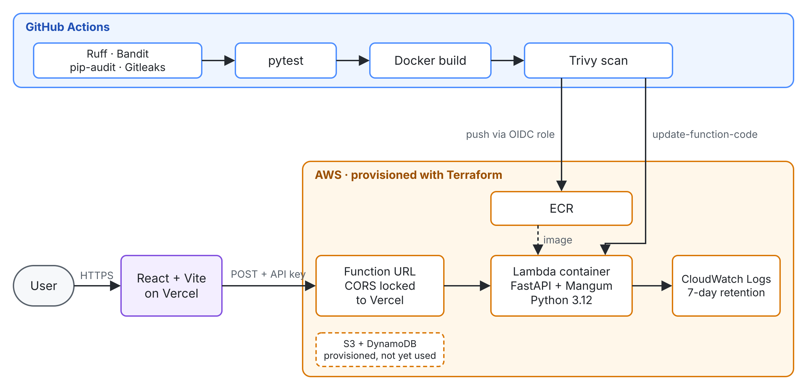

# BoxdMetrics

> Upload your Letterboxd CSV export and get a few stats about your viewing: total films, favourite decade, average rating and the weekday you watch most. A personal portfolio project: a FastAPI backend on AWS Lambda, deployed by a GitHub Actions pipeline with security checks, with the infrastructure defined in Terraform.

[](https://github.com/paulobarb/BoxdMetrics/actions)
[](infra/terraform/)
[](LICENSE)

Live demo: [boxd-metrics.vercel.app](https://boxd-metrics.vercel.app)

## Overview

Every push or pull request to `main` that touches the backend runs five security checks in GitHub Actions (Gitleaks, Ruff, Bandit, pip-audit and Trivy). On a push, if they all pass, the pipeline pushes the container image to ECR and points the Lambda function at it. Terraform defines the AWS side.

- The backend runs on Lambda, which should cost about $0.55/month at current traffic (an estimate, not taken from an AWS bill). The ECS Fargate version it replaced cost $20 or more.
- GitHub Actions logs in to AWS through OIDC, so no AWS keys are stored in the repository or in GitHub secrets.
- The API only accepts CORS requests from the Vercel site, has a basic rate limit, and runs under IAM roles that only reach the resources it uses. The [known gaps](#known-gaps) section lists what is still weak.

## Architecture



<sub>Editable source: [`docs/architecture.svg`](docs/architecture.svg).</sub>

## Tech stack

| Category | Technology | Security role |
|----------|-----------|---------------|
| Frontend | React, Vite | Static site on Vercel; the API key it sends is public (see [API key](#api-key-not-a-secret)) |
| Backend | FastAPI, Python | Input validation, type checking, rate limiting |
| Serverless | AWS Lambda (Mangum) | No long-running server to attack; each function has its own IAM role |
| Container | Docker multi-stage on the AWS Lambda Python base image | Build tools stay in the builder stage |
| Registry | Amazon ECR | Image scanning on push, AES-256 encryption at rest |
| CI/CD | GitHub Actions | OIDC authentication, no long-lived AWS keys |
| SAST | Bandit, Ruff | Python vulnerability and lint checks |
| Secrets | Gitleaks | Secret detection in CI |
| Dependencies | pip-audit | Known CVEs in Python dependencies |
| Images | Trivy | OS and library vulnerabilities in the built image |
| IaC | Terraform | Version-controlled infrastructure |
| Auth | AWS IAM + OIDC | Federated identity for CI |
| Monitoring | CloudWatch Logs (prod), Prometheus + Grafana (local) | No alerting yet |

## Infrastructure as code

The `infra/` directory holds two versions of the infrastructure.

### [Current: serverless Lambda (V2)](infra/terraform/)

```hcl
# resources: Lambda, ECR, IAM, CloudWatch
# also provisioned for upcoming persistence: S3 (CSV uploads), DynamoDB (stats)
# cost: ~$0.55/month at current usage
# cold start: ~10 s observed (not formally measured yet)
```

- The Function URL only accepts CORS requests from the Vercel origin and two localhost ports.
- Lambda memory is set to 512 MB.
- CloudWatch keeps logs for 7 days, to keep log storage cheap.

### [Legacy: ECS Fargate (V1)](infra/terraform-legacy/)

```hcl
# resources: ECS Cluster, Fargate Tasks, VPC
# cost: ~$20+/month (always-on)
# use case: Sustained load, custom networking requirements
```

Kept for reference. Its README explains why the project moved to Lambda.

## Local development

Prerequisites: Docker, Docker Compose, Node.js 22+

```bash
# Clone repository
git clone https://github.com/paulobarb/BoxdMetrics.git
cd BoxdMetrics

# Start frontend + backend + monitoring stack
docker-compose up --build -d
```

| Service | URL | Purpose |
|---------|-----|---------|
| Frontend | http://localhost:5174 | React app |
| API | http://localhost:8000 | FastAPI backend |
| API docs | http://localhost:8000/docs | OpenAPI/Swagger UI |
| Prometheus | http://localhost:9090 | Metrics scraping |
| Grafana | http://localhost:3000 | Dashboards (anonymous access with the Admin role) |

## Monitoring

### Production (CloudWatch)

No alarms exist yet. These are the thresholds planned for them:

| Metric | Source | Planned alert threshold |
|--------|--------|-------------------------|
| Invocations | Lambda | None (usage tracking only) |
| Duration | Lambda | > 5 s (p99 latency, cold starts) |
| Errors | Lambda | > 1% error rate |

### Local (Prometheus + Grafana)

Docker Compose loads two dashboards:

- [AppHealth.json](infra/monitoring/grafana/AppHealth.json) shows RED metrics: request rate, p95 latency and error rate, which is what users notice.
- [Infrastructure.json](infra/monitoring/grafana/Infrastructure.json) shows USE metrics: CPU, memory growth and container restarts, for spotting leaks and resource limits.

[infra/monitoring/README.md](infra/monitoring/) describes each panel.

## Security

```
┌─────────────────────────────────────────────────────────────────────────────┐
│  THREAT MODEL                                                               │
├─────────────────────────────────────────────────────────────────────────────┤
│                                                                             │
│  Threat: Unauthorized API Access                                            │
│  Mitigation: X-API-Key header check. The key ships in the frontend bundle,  │
│  so it only filters casual traffic; see "API key" below                     │
│                                                                             │
│  Threat: Credential Leakage (Git commit)                                    │
│  Mitigation: Zero-config 'dummy' keys for local dev + GitHub Secrets        │
│                                                                             │
│  Threat: Dependency Supply Chain Attack                                     │
│  Mitigation: pip-audit CVE scanning + lock files                            │
│                                                                             │
│  Threat: Container Escape                                                   │
│  Mitigation: AWS Lambda base image + Trivy scanning + least-privilege role  │
│                                                                             │
│  Threat: DDoS / Billing Attack                                              │
│  Mitigation: CORS origin blocking + rate limiting (slowapi)                 │
│  Note: Redis-backed locally; in-memory per Lambda instance in production    │
│                                                                             │
│  Threat: Injection (CSV parsing)                                            │
│  Mitigation: Pandas strict column validation, size limits (2MB max)         │
│                                                                             │
│  Threat: IAM Privilege Escalation                                           │
│  Mitigation: Least-privilege roles, OIDC trust limited to this repository   │
└─────────────────────────────────────────────────────────────────────────────┘
```

### API key (not a secret)

The frontend sends the key in the `X-API-Key` header, and Vite writes `VITE_*` variables into the JavaScript bundle at build time. Anyone can read it in the browser's DevTools, so treat it as public.

The key blocks requests from anyone who hasn't copied it from the app. It doesn't authenticate users, and it doesn't stop someone calling the API directly with `curl`. CORS doesn't stop that either, because only browsers enforce CORS.

What limits abuse today:
- 3 requests per minute per client. In production the limiter identifies the client by the first IP in the `X-Forwarded-For` header, which the client can set itself, so it only slows down casual traffic. The counter also lives in each Lambda instance's memory, so it resets on cold starts and isn't shared between instances.
- 2 MB file size limit.
- No data is stored. Each uploaded CSV is processed in memory and discarded; nothing is written to S3 or DynamoDB yet.

To make the key a real secret, the frontend would need to call a server-side proxy (for example a Vercel function) that adds the key, so it never reaches the browser.

### Known gaps

These are open, most of them found by a Semgrep scan:
- The rate limit trusts `X-Forwarded-For` (see above). Keying it on the source IP from the Lambda request context would fix that.
- If `API_SECRET_KEY` is not set, `core/config.py` falls back to `dev_secret_123`. Terraform always sets the variable in production, but the 503 "API key not configured" check in `core/security.py` can never trigger.
- Both Dockerfiles run as root; neither has a `USER` line.
- GitHub Actions are referenced by tag (`@v4`), not by commit SHA.
- The local Redis connection uses `redis://`, without TLS. It only runs inside Docker Compose.
- CI runs pip-audit with `--ignore-vuln CVE-2026-4539`.
- ECR tags are mutable and DynamoDB has no customer-managed KMS key (see the [Terraform README](infra/terraform/README.md#known-gaps)).

## Tests

CI runs the whole test suite: the ETL unit tests (`test_etl.py`) and the API route tests (`test_routes.py`), which cover auth, rate limiting and upload validation.

```bash
# Unit tests (pytest)
cd src/backend
pytest tests/ -v

# Security scan (Bandit)
bandit -r . -x tests/

# Dependency audit
pip-audit -r requirements.txt

# Local security check
docker run --rm -v $(pwd):/code aquasec/trivy fs /code
```

## Project structure

```
BoxdMetrics/
├── src/
│   ├── backend/
│   │   ├── api/routes.py          # FastAPI endpoints
│   │   ├── core/
│   │   │   ├── security.py         # Auth, rate limiting
│   │   │   └── config.py           # Environment config
│   │   ├── services/
│   │   │   └── etl_letterboxd.py   # CSV processing logic
│   │   ├── main.py                 # Lambda handler entry
│   │   ├── Dockerfile              # Local development
│   │   ├── Dockerfile.aws          # Production Lambda image
│   │   └── tests/
│   │       ├── test_routes.py      # API integration tests
│   │       └── test_etl.py         # ETL unit tests
│   └── frontend/
│       ├── src/App.jsx             # React components
│       └── Dockerfile
├── infra/
│   ├── terraform/                  # Current Lambda infrastructure
│   ├── terraform-legacy/           # Documented ECS evolution
│   └── monitoring/                 
│       ├── prometheus.yml          # Scrape configurations
│       └── grafana/                # Provisioning & JSON Dashboards
├── .github/workflows/
│   └── backend.yml                 # CI/CD pipeline
├── docker-compose.yaml             # Local orchestration
└── README.md
```

## Performance

| Metric | Value | Notes |
|--------|-------|-------|
| Cold start | ~10 s (observed) | First request after the function has been idle, as seen in the browser. Not formally measured yet; to be confirmed with CloudWatch `Init Duration` |
| Warm response | <200 ms (estimate) | Not measured yet |
| Max file size | 2 MB | CSV upload limit |
| Rate limit | 3 req/min per client | Set in `api/routes.py`; can be bypassed (see [known gaps](#known-gaps)) |
| Monthly cost | ~$0.55 (estimate) | Not taken from an AWS bill. Lambda usage fits in the free tier; most of the estimate is CloudWatch Logs |

## License

MIT. See [LICENSE](LICENSE).

## Contact

Built by [Paulo Barbosa](https://github.com/paulobarb)
